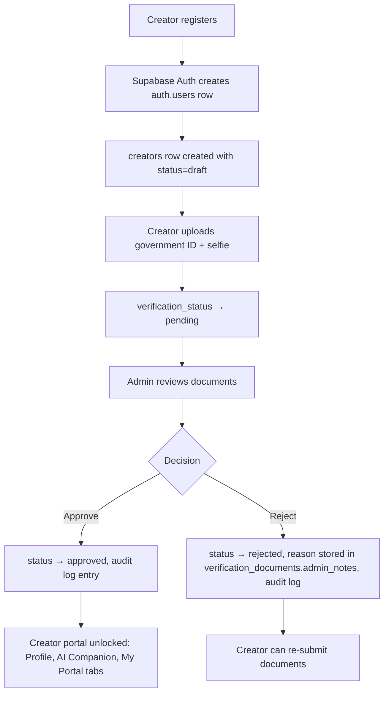
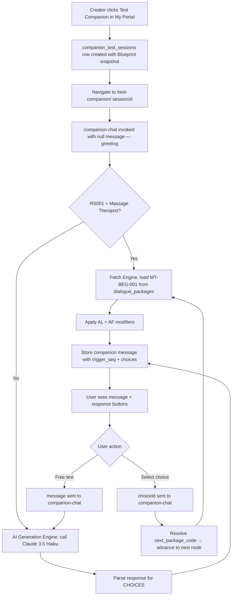
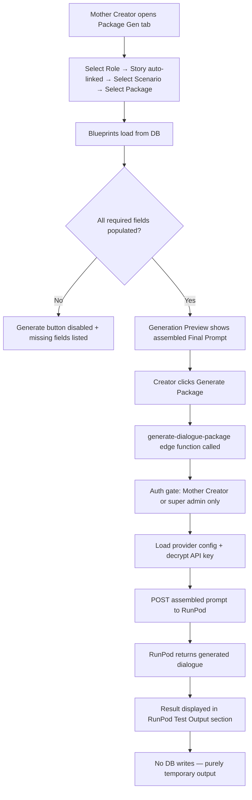

# Creator Portal AI — Master Blueprint

**Version:** 1.0  
**Date:** 2026-07-07  
**Status:** Active Development  
**Purpose:** Complete functional specification for senior engineers continuing development without prior context.

---

## Table of Contents

1. [Project Vision](#1-project-vision)
2. [User Types & Access Model](#2-user-types--access-model)
3. [Application Architecture](#3-application-architecture)
4. [Functional Modules](#4-functional-modules)
5. [Blueprint System](#5-blueprint-system)
6. [Database Architecture](#6-database-architecture)
7. [Dialogue Generation Pipeline](#7-dialogue-generation-pipeline)
8. [Image Generation Pipeline](#8-image-generation-pipeline)
9. [Client Conversation Engine](#9-client-conversation-engine)
10. [AI Infrastructure](#10-ai-infrastructure)
11. [Functional Workflows](#11-functional-workflows)
12. [Development Status](#12-development-status)
13. [Design Principles](#13-design-principles)
14. [Future Roadmap](#14-future-roadmap)
15. [Known Technical Debt](#15-known-technical-debt)
16. [Appendix](#16-appendix)

---

## 1. Project Vision

Creator Portal AI is a B2B2C SaaS platform that enables verified content creators to deploy AI companion chat experiences for their audiences. Creators configure a personalised AI companion identity; clients interact with it through a public portal. The platform's long-term goal is to deliver fully scripted, media-rich AI companion conversations — combining pre-authored dialogue, dynamically generated images, and future voice/video assets — within a structured narrative engine.

### Core Pillars

| Pillar | Description |
|--------|-------------|
| **Creator Portal** | Verified creators configure their AI companion identity, upload assets, and manage their public portal |
| **Package Engine** | Structured conversation graph navigating creators through Role → Scenario → Package nodes |
| **Dialogue Library** | Canonical authored dialogue powering the Fetch Engine in production |
| **Image Engine** | Scene-specific AI-generated images linked to conversation packages |
| **Enhancement Engine** | Per-user personalisation layer applying Attachment, Affection, and Flirting modifiers to canonical dialogue |
| **Client Portal** | Public `/creator/:slug` URL delivering the companion chat experience |

---

## 2. User Types & Access Model

### 2.1 User Hierarchy

```
Super Admin (Mother Creator)
    └── Admin
            └── Creator (Verified)
                        └── Creator (Pending/Draft)
Client (Anonymous)
```

### 2.2 User Type Definitions

| Type | Email / Flag | Capabilities |
|------|-------------|--------------|
| **Mother Creator** | `test.test@gmail.com` | All super admin capabilities + Package Generation dev tools |
| **Super Admin** | `is_super_admin = true` | Provider Configuration, Admin Management, all admin capabilities |
| **Admin** | `role = 'admin'` | Creator verification, audit log, identity review |
| **Creator (Verified)** | `verification_status = 'approved'` | Profile setup, AI Companion config, My Portal, Test Companion |
| **Creator (Pending)** | `verification_status = 'pending'` | Verification upload only |
| **Creator (Draft)** | `verification_status = 'draft'` | Verification upload only |
| **Client** | Anonymous (no login) | Public portal chat (unauthenticated) |

### 2.3 Verification Status Flow

```
draft ──► pending ──► approved
                  └─► rejected ──► (re-submit) ──► pending
```

The `draft` status was added to distinguish creators who registered but have not yet started the verification process (previously all unsubmitted accounts showed as `pending`).

### 2.4 Key Flags

- `creators.is_super_admin` — boolean, hardened against self-elevation via `is_super_admin()` Postgres function
- `creators.is_content_master` — boolean, reserved for the Master Content Account (not yet implemented in UI)
- `creators.role` — `'creator'` or `'admin'`

---

## 3. Application Architecture

### 3.1 Technology Stack

| Layer | Technology |
|-------|------------|
| Frontend | React 18, TypeScript, Vite |
| Styling | Tailwind CSS (custom design system) |
| Database | Supabase (PostgreSQL 15) |
| Auth | Supabase Auth (email/password) |
| Edge Functions | Supabase Edge Functions (Deno runtime) |
| Storage | Supabase Storage (S3-compatible) |
| AI — Dialogue Modifier | Anthropic Claude 3.5 Haiku via `ANTHROPIC_API_KEY` secret |
| AI — Image Generation | fal.ai via `generate-image-package` edge function |
| AI — Dialogue Generation | RunPod serverless (configured via `provider_configurations` table) |
| Routing | React Router v6 |

### 3.2 Route Map

```
/                           → LandingPage (public)
/login                      → LoginPage
/register                   → RegisterPage
/forgot-password            → ForgotPasswordPage
/reset-password             → ResetPasswordPage

/dashboard                  → CreatorDashboard (protected: creator)
/verification-upload        → VerificationPage (protected: creator)

/admin                      → AdminDashboard (protected: admin)
/admin/verifications        → AdminVerificationsPage
/admin/audit                → AdminAuditPage
/admin/management           → AdminManagementPage
/admin/identity-review      → IdentityReviewPage
/admin/provider-config      → ProviderConfigPage (super admin only)

/creator/:slug              → ClientPortal (public, no auth)
/test-companion/:sessionId  → TestCompanionPage (protected: creator)
```

### 3.3 Authentication Context

`AuthContext` (`src/context/AuthContext.tsx`) exposes:

```typescript
interface AuthCtx {
  session: Session | null;
  user: User | null;
  creator: Creator | null;       // Full creators row
  loading: boolean;
  creatorFetchFailed: boolean;   // True when retry exhausted
  signOut: () => Promise<void>;
  refreshCreator: () => Promise<void>;
}
```

**Retry logic:** `fetchCreatorWithRetry` retries 8 times with 500ms delay to handle the race between Supabase Auth trigger creating the `auth.users` row and the application creating the `creators` row on registration.

**onAuthStateChange deadlock guard:** The context uses a `fetchingRef` flag and `pendingUid` queue to serialise concurrent auth state changes and prevent duplicate fetches.

### 3.4 Edge Function Pattern

All edge functions follow this security pattern:

```typescript
// User authentication check (anon key + bearer token)
const userDb = createClient(SUPABASE_URL, SUPABASE_ANON_KEY, {
  global: { headers: { Authorization: authHeader } }
});

// Privileged DB operations (service role, bypasses RLS)
const adminDb = createClient(SUPABASE_URL, SUPABASE_SERVICE_ROLE_KEY);
```

---

## 4. Functional Modules

### 4.1 Creator Dashboard Tabs

The `CreatorDashboard` renders a tab-based interface. Tabs are conditionally shown:

| Tab ID | Label | Component | Access Gate |
|--------|-------|-----------|-------------|
| `verification` | Verification | `VerificationUpload` | All creators |
| `profile` | Profile & AI | `ProfileSetup` | Approved only |
| `companion` | AI Companion | `AICompanionSetup` | Approved only |
| `portal` | My Portal | `MyPortal` | Approved only |
| `generation` | Package Gen | `PackageGenerationPage` | Mother Creator / Super Admin only |

`MyPortal` contains nested sub-navigation (Dialogue Library, Image Library, Scenario Library, Appearance Library, Uniform Library) implemented within the component.

### 4.2 Admin Portal Modules

| Page | Route | Capability |
|------|-------|------------|
| **AdminDashboard** | `/admin` | Creator list, verification review, approve/reject with audit log |
| **AdminVerificationsPage** | `/admin/verifications` | Dedicated verification queue |
| **AdminAuditPage** | `/admin/audit` | Admin action audit log with admin email |
| **AdminManagementPage** | `/admin/management` | Promote/demote admins (super admin only) |
| **IdentityReviewPage** | `/admin/identity-review` | Document viewer for ID + selfie review |
| **ProviderConfigPage** | `/admin/provider-config` | RunPod/external provider configuration (super admin only) |

### 4.3 Client Portal

`/creator/:slug` — publicly accessible, no login required. Loads creator and profile data by username. Shows welcome message on load. Currently uses a **static fallback response pool** (not wired to the production Fetch Engine). The real production chat engine (`companion-chat`) is used via `TestCompanionPage`.

---

## 5. Blueprint System

### 5.1 Overview

The Blueprint System is the data model that defines an AI companion's personality, behaviour, communication style, relationship dynamics, and content boundaries. A Blueprint is a flat key→value snapshot stored in `companion_test_sessions.blueprint`.

### 5.2 Segment Codes

Segment codes are permanent identifiers. They must never be changed or reused.

```
AID — AI Identity
  AID001  Name
  AID002  Gender
  AID003  Age (18–60)

PS — Personality
  PS001   Core Personality Type
  PS002   Personality Intensity (1–5)
  PS003   Emotional Style
  PS004   Flirting Style (1–5)
  PS005   Personality Description

COM — Communication
  COM001  Conversation Pace (Fast / Balanced / Slow)
  COM002  Initiative Level (1–5)
  COM003  Response Length (Short / Balanced / Detailed)
  COM004  Engagement Style
  COM005  Story Guidance Level (Minimal / Guided / Immersive)
  COM006  Conversation Consistency (1–5)

RS — Relationship Style
  RS001   Relationship Dynamic (e.g. "Massage Therapist")
  RS002   Attachment Level (Balanced / Attached / Deeply Attached)
  RS003   Affection Level (Low / Medium / High)
  RS004   Relationship Description

BP — Boundaries & Permissions
  BP001   Media Permission
  BP002   Escalation Level
  BP003   (reserved — future)
  BP004   (reserved — future)
```

Source of truth: `companion_segment_registry` table and `src/lib/engineCodes.ts`.

### 5.3 Modifier Resolution

Modifiers are resolved from Blueprint values at runtime:

| Code | Source | Map |
|------|--------|-----|
| AL-001/002/003 | RS002 (Attachment) | Balanced→AL-001, Attached→AL-002, Deeply Attached→AL-003 |
| AF-001/002/003 | RS003 (Affection) | Low→AF-001, Medium→AF-002, High→AF-003 |
| FL-001/002/003 | PS004 (Flirting 1–5) | 1–2→FL-001, 3–4→FL-002, 5→FL-003 |

### 5.4 Package Generation Blueprint System

The Package Generation pipeline uses a 4-layer blueprint assembled at generation time. All fields are sourced from the database.

#### Layer 1 — Generation Rules (Static)
Embedded in `PackageGenerationPage.tsx` as `GENERATION_RULES`. Not stored in DB. Not user-editable. Applied to every generation request.

#### Layer 2 — Role Blueprint
Sourced from `engine_role_definitions`:
- `target_audience`, `generation_type`, `description`, `core_characteristics`

#### Layer 3 — Story Blueprint
Also sourced from `engine_role_definitions` (1:1 with Role in v1):
- `story_name`, `story_goal`, `current_story`

#### Layer 4 — Scenario Blueprint
Sourced from `engine_scenario_registry`:
- `scene`, `current_relationship`, `scenario_goal`

#### Layer 5 — Package Blueprint
Sourced from `engine_package_registry`:
- `purpose`, `scene`, `current_relationship`, `emotion`, `conversation_goal`, `target_outcome`, `word_count_range`, `must_include`, `must_avoid`

---

## 6. Database Architecture

### 6.1 Schema Overview

```
auth.users (Supabase managed)
    │
    └── creators (1:1)
            ├── verification_documents (1:many)
            ├── creator_profiles (1:1)
            ├── admin_audit_log (1:many, as admin)
            ├── companion_test_sessions (1:many)
            │       └── companion_test_messages (1:many)
            ├── role_image_library (1:many)
            └── creator_appearance_profiles (1:1)
```

### 6.2 Core Creator Tables

#### `creators`
| Column | Type | Notes |
|--------|------|-------|
| id | uuid PK | References auth.users |
| email | text UNIQUE | |
| username | text UNIQUE | Used as portal slug |
| country | text | |
| role | text | `creator` \| `admin` |
| is_super_admin | boolean | Platform-level privilege |
| is_content_master | boolean | Master content account flag |
| verification_status | text | `draft` \| `pending` \| `approved` \| `rejected` |
| created_at | timestamptz | |

#### `verification_documents`
| Column | Type | Notes |
|--------|------|-------|
| id | uuid PK | |
| creator_id | uuid FK | → creators |
| government_id_url | text | Storage path in `verification-docs` bucket |
| selfie_url | text | Storage path |
| admin_notes | text | Rejection reason written by admin |
| uploaded_at | timestamptz | |

#### `creator_profiles`
Stores the creator's public persona and AI companion configuration. Contains ~35 columns covering:
- Display: `display_name`, `bio`, `welcome_message`, `avatar_url`
- AI Identity: `ai_companion_name`, `ai_companion_gender`, `ai_companion_age`
- Personality: `ai_companion_personality_type`, `ai_companion_personality_intensity`, `ai_companion_emotional_style`, `ai_companion_flirting_style`, `ai_companion_personality_desc`
- Communication: `ai_comm_*` (pace, initiative, response length, engagement, story guidance, consistency)
- Relationship: `ai_rel_*` (dynamic, attachment, affection level, affection category, description)
- Boundaries: `ai_bp_*` (media permissions, escalation, creator instructions)
- Face Photos: `front_face_photo_url`, `left_face_photo_url`, `right_face_photo_url`
- Status: `creator_consent`, `updated_at`

### 6.3 Engine Tables (Package System)

#### `engine_package_registry`
Central registry for all package codes. One row per package node.

| Column | Type | Notes |
|--------|------|-------|
| code | text PK | e.g. `MT-001`, `MT-BEG-001` |
| package_group | text | e.g. `MT` |
| label | text | Display name |
| description | text | |
| parent_code | text | Hierarchical parent |
| package_type | text | `role` \| `stage` \| `media` \| `image` |
| sort_order | int | |
| purpose | text | Package Blueprint field |
| scene | text | Package Blueprint field |
| current_relationship | text | Package Blueprint field |
| emotion | text | Package Blueprint field |
| conversation_goal | text | Package Blueprint field |
| target_outcome | text | Package Blueprint field |
| word_count_range | text | e.g. "70–90 words" |
| must_include | text | Hard content requirement |
| must_avoid | text | Hard exclusion rule |
| dialogue_count | int | Legacy — not used in Package Gen pipeline |
| words_per_dialogue | int | Legacy — superseded by `word_count_range` |
| must_include | text | |
| must_avoid | text | |

#### `engine_role_definitions`
Detailed blueprint data per role.

| Column | Type | Notes |
|--------|------|-------|
| package_code | text PK | → engine_package_registry (role-type only) |
| description | text | Role description |
| core_characteristics | text[] | |
| human_nature | text[] | |
| target_audience | text | e.g. "18+" |
| generation_type | text | e.g. "NSFW" |
| story_name | text | |
| story_goal | text | |
| current_story | text | e.g. "Beginning" |
| stage_objectives | jsonb | |
| modifier_tones | jsonb | |
| attachment_modifiers | jsonb | AL code → {label, traits} |
| affection_modifiers | jsonb | AF code → {label, traits, behavior, examples} |
| emotional_journey | jsonb | Package code → {client_emotions, mt_goals, desired_outcome} |

#### `engine_scenario_registry`
Scenario paths within a role (selection happens after BEGIN package completes).

| Column | Type | Notes |
|--------|------|-------|
| code | text PK | e.g. `MT-SC-001` |
| role_code | text FK | → engine_package_registry |
| label | text | |
| description | text | |
| hint | text | Transition dialogue at scenario end |
| scene | text | Scenario Blueprint field |
| current_relationship | text | Scenario Blueprint field |
| scenario_goal | text | Scenario Blueprint field |
| sort_order | int | |
| is_active | boolean | |

Current MT scenarios: `MT-SC-001` (First Visit), `MT-SC-002` (Stress Relief), `MT-SC-003` (Relaxation), `MT-SC-004` (Follow-up).

#### `engine_scenario_packages`
Junction table: scenario ↔ package.

| Column | Type | Notes |
|--------|------|-------|
| scenario_code | text | → engine_scenario_registry |
| package_code | text | → engine_package_registry |
| package_role | text | `main` \| `final` |
| sort_order | int | |

### 6.4 Dialogue Library Tables

#### `dialogue_packages`
Canonical authored dialogue content. The Fetch Engine reads from this table.

| Column | Type | Notes |
|--------|------|-------|
| package_code | text UNIQUE FK | → engine_package_registry |
| role_code | text | |
| stage | text | `beginning` \| `middle` \| `ending` |
| sequence | int | |
| dialogue_text | text | The actual dialogue delivered to the client |
| emotion | text | |
| camera_angle | text | |
| scene_context | text | |
| generation_status | text | `pending` \| `generating` \| `generated` \| `failed` |
| generation_metadata | jsonb | Blueprint provenance |
| is_system | boolean | True = Master Content Account dialogue |
| creator_id | uuid | Null for system dialogue |

**Live packages:** MT-BEG-001, MT-MID-001, MT-END-001

#### `dialogue_package_responses`
Response options (up to 3) per dialogue package. `next_package_code = NULL` signals terminal.

#### `dialogue_package_assets`
Maps asset codes (not URLs) to packages. `asset_type` references `asset_type_registry`.

#### `asset_type_registry`
Registry of asset types: `image`, `voice`, `video`, `animation`, `expression`, `motion`, `ambient_audio`. New types require only an INSERT row.

### 6.5 Test Session Tables

#### `companion_test_sessions`
| Column | Type | Notes |
|--------|------|-------|
| id | uuid PK | Used as sessionId in URL |
| creator_id | uuid | Session owner |
| blueprint | jsonb | Complete CompanionBlueprint snapshot |
| engine_state | jsonb | Current EngineState (navigation position) |
| created_at | timestamptz | |

#### `companion_test_messages`
| Column | Type | Notes |
|--------|------|-------|
| session_id | uuid FK | |
| role | text | `user` \| `companion` |
| content | text | Message text |
| image_url | text | Legacy (deprecated) |
| message_type | text | `text` \| `image` |
| trigger_seq | int | Image package sequence (1–10) |
| choices | jsonb | Array of {id, label} response choices |

### 6.6 Image Library Tables

#### `role_image_library`
Per-creator image assets linked by `image_code` (e.g. `MT-IMG-001`).

| Column | Type | Notes |
|--------|------|-------|
| creator_id | uuid FK | |
| image_code | text | e.g. `MT-IMG-001` |
| image_url | text | Delivered URL after generation |
| generation_status | text | `pending` \| `generated` \| `failed` |

### 6.7 Provider Configuration Table

#### `provider_configurations`
| Column | Type | Notes |
|--------|------|-------|
| provider_name | text | RunPod, OpenAI, Anthropic, Ollama, Custom |
| provider_url | text | Full endpoint URL |
| api_key_enc | text | AES-256-GCM encrypted API key |
| api_key_configured | boolean | Computed: true when api_key_enc is set |
| connection_status | text | `connected` \| `offline` \| `unknown` |
| health_status | text | `n/a` (current) |
| is_active | boolean | Enforced single-row by DB trigger |
| last_health_check | timestamptz | |

**Security:** `api_key_enc` is encrypted server-side via `_shared/crypto.ts` using AES-256-GCM. The raw key never touches the DB. Only service-role edge functions can decrypt it. A trigger (`trg_single_active_provider`) ensures only one active provider at a time.

### 6.8 RLS Policy Summary

| Table | Anon | Creator (own) | Admin | Super Admin |
|-------|------|---------------|-------|-------------|
| creators | SELECT approved | SELECT/INSERT/UPDATE/DELETE own | SELECT/UPDATE all | All |
| verification_documents | — | All own | SELECT/UPDATE | All |
| creator_profiles | SELECT (approved creators) | All own | SELECT | All |
| engine_package_registry | — | SELECT | SELECT | All |
| engine_scenario_registry | — | SELECT | SELECT | All |
| dialogue_packages | — | SELECT system + own | — | All |
| companion_test_sessions | — | All own | — | All |
| provider_configurations | — | — | — | All |

### 6.9 Migrations Timeline

| Migration | Description |
|-----------|-------------|
| 20260610161043 | Core creator portal schema v1 |
| 20260611223342 | Super admin role hardening + `is_super_admin()` function |
| 20260616150413 | Engine package registry |
| 20260616154007 | Engine role definitions |
| 20260618174749 | Scenario architecture |
| 20260629004859 | Dialogue package tables (Library) |
| 20260704090332 | BEG stage sequential progression |
| 20260705135833 | Provider configurations |
| 20260705152146 | API key encryption (AES-256-GCM) |
| 20260707104234 | Role/Story blueprint fields |
| 20260707104245 | Scenario blueprint fields |
| 20260707112410 | Package blueprint fields v2 (scene, emotion, word_count_range) |
| 20260707112453 | Seed MT-001 / MT-SC-001 / MT-BEG-001 blueprint data |

---

## 7. Dialogue Generation Pipeline

### 7.1 Architecture

The Dialogue Generation pipeline is the system that creates new dialogue content for packages. It is separate from the Conversation Engine that delivers existing dialogue to clients.

```
PackageGenerationPage (UI)
        │
        │  POST { prompt }
        ▼
generate-dialogue-package (Edge Function)
        │
        │  1. Auth check (Mother Creator or Super Admin only)
        │  2. Load provider config from provider_configurations
        │  3. Decrypt api_key_enc with AES-256-GCM
        │  4. POST to RunPod serverless endpoint
        │
        ▼
RunPod Serverless Endpoint
        │
        ▼
  Generated Dialogue Text
        │
        ▼
generate-dialogue-package (response)
        │
        │  Returns: { status, generation_time_ms, output, provider_name }
        │  NO database writes (development/verification phase)
        ▼
PackageGenerationPage (displays test output)
```

### 7.2 Final Prompt Structure

The assembled prompt sent to RunPod follows this 5-layer structure:

```
────────────────────────────────────────────────────
 GENERATION RULES
────────────────────────────────────────────────────
[Static rules: 11 hard rules + output format]

────────────────────────────────────────────────────
 ROLE BLUEPRINT  ·  MT-001: Massage Therapist
────────────────────────────────────────────────────
Role: MT-001 — Massage Therapist
Target Audience: 18+
Generation Type: NSFW
Role Description: ...
Core Personality: Warm and welcoming, Calm and patient, ...

────────────────────────────────────────────────────
 STORY BLUEPRINT  ·  Massage Therapist
────────────────────────────────────────────────────
Story Name: First Client Journey
Story Goal: Guide a new client from greeting, to trust...
Current Story: Beginning

────────────────────────────────────────────────────
 SCENARIO BLUEPRINT  ·  MT-SC-001: First Visit
────────────────────────────────────────────────────
Scenario Code: MT-SC-001
Scenario Name: First Visit
Scene: Client has just entered the massage studio.
Current Relationship: First meeting.
Scenario Goal: ...
Expected Ending: ...

────────────────────────────────────────────────────
 PACKAGE BLUEPRINT  ·  MT-BEG-001
────────────────────────────────────────────────────
Package Code: MT-BEG-001
Package Name: Warm Welcome
Purpose: Welcome the client and create a comfortable first impression.
Scene: Client has just entered the massage studio.
Current Relationship: First meeting.
Emotion: Warm, Calm, Professional
Conversation Goal: Help the client feel comfortable and at ease.
Target Outcome: Naturally move toward consultation.
Word Count Range: 70–90 words
Must Include: Greeting. Invitation to sit. Friendly tone.
Must Avoid: Romantic comments. Massage starts. Goodbye. Future promises.
```

### 7.3 Generation Rules (Hard Rules)

Embedded as a static constant in `PackageGenerationPage.tsx`. Not database-stored. Not user-editable. Current rules (Rule 0–11):

| # | Rule |
|---|------|
| 0 | Never invent information not in blueprints. No assumptions, inferences, or expanded logic. |
| 1 | Generate dialogue for THIS ONE PACKAGE ONLY |
| 2 | Stay fully in character as defined in the Role Blueprint |
| 3 | Dialogue must match Role Blueprint (Target Audience, Generation Type, Core Personality) |
| 4 | Story Blueprint defines the overarching narrative goal |
| 5 | Scenario Blueprint defines specific scene, relationship state, scenario goal |
| 6 | Package Blueprint defines exact objective, word count range, content rules |
| 7 | Respect Must Include and Must Avoid absolutely |
| 8 | Each dialogue must contain 70–90 words exactly as specified |
| 9 | Emotion defines the tone — maintain throughout every line |
| 10 | Output must be natural, warm, appropriate to companion style |
| 11 | Every generated dialogue must be unique — no repeats for same package |

### 7.4 Validation Gate

Before the Generate button is enabled, `validateBlueprints()` checks all required fields across all 4 blueprint layers. If any field is empty, the button remains disabled and a missing-fields warning panel lists exactly which fields need to be filled. **RunPod must never receive prompts containing empty fields, "Not configured" text, or null values.**

### 7.5 Current Development Status

**Phase: Development / Pipeline Verification**

- Generate button sends prompt to RunPod and displays raw output
- No database writes (dialogue is not saved to `dialogue_packages`)
- Output is shown in "RunPod Test Output" section marked "Temporary · Not saved"
- Chat is completely unaffected
- Access gated to Mother Creator (`test.test@gmail.com`) and super admins only

---

## 8. Image Generation Pipeline

### 8.1 Architecture

```
TestCompanionPage (Story Panel)
        │
        │  Invoke generate-image-package { packageCode }
        ▼
generate-image-package (Edge Function)
        │
        │  Calls fal.ai image generation API
        │  Stores result URL in role_image_library
        │
        ▼
role_image_library (DB)
        │
        ▼
TestCompanionPage (View Photo button)
```

### 8.2 Image Package Codes

| Code | Sequence | Stage | Description |
|------|----------|-------|-------------|
| MT-IMG-001 | 1 | Beginning | Linked to MT-BEG-001 |
| MT-IMG-002–003 | 2–3 | Beginning | Additional beginning scenes |
| MT-IMG-004–006 | 4–6 | Middle | Session in progress |
| MT-IMG-007–009 | 7–9 | Ending | Session conclusion |
| MT-IMG-010 | 10 | Special | Additional |

### 8.3 Image Availability Check

On session load, `TestCompanionPage` queries `role_image_library` for the creator's generated images. Each companion message with a `trigger_seq` gets a "View Photo" button if the image is ready, or "Generate Image" if not.

### 8.4 Session Storage Persistence

Photo visibility state is persisted to `sessionStorage` with key `photo-visible-{sessionId}-{packageCode}`. Expanded photos survive page scrolls and re-renders within the same session.

### 8.5 Monetisation Hook

`handleViewPhoto` is the documented single integration point for future monetisation (subscription checks, credit deductions, unlock flows). Currently no gate — any creator can view any generated image.

---

## 9. Client Conversation Engine

### 9.1 Dual Engine Architecture

The `companion-chat` edge function routes between two engines based on `blueprint.RS001`:

```typescript
const isFetchMode = !!startingPackageForRole(blueprint.RS001);
// RS001 = "Massage Therapist" → Fetch Engine
// Any other value → AI Generation Engine
```

### 9.2 Fetch Engine (Production Path)

Used for the Massage Therapist role. Reads pre-authored dialogue from the Master Content Library.

#### Navigation Model

```
Session Start
      │
      ▼
Greeting (no engineState) → MT-BEG-001
      │
      ▼
Companion message delivered with response choices
      │
      ▼ (user selects choice)
next_package_code routing
      │
      ├──► NULL → Terminal (session ends)
      └──► MT-MID-001, MT-END-001, etc.
```

#### Modifier Application

Every canonical dialogue message passes through two modifier layers before delivery:

1. **AL Modifier (Attachment):** Applied if `alCode != AL-001`. Uses Claude 3.5 Haiku to rewrite. Falls back to appended sentence if API unavailable.
2. **AF Modifier (Affection):** Applied if `afCode != AF-001`. Uses Claude 3.5 Haiku. Falls back to emoji append / "dear" insertion.

#### Enhancement Engine

The Enhancement Engine sits between dialogue fetch and delivery. It performs a live health check against the configured provider on every request. The result determines the `providerStatus` returned to the debug panel but **never changes what the user receives** — dialogue always comes from the Canonical Library.

```typescript
interface ProviderStatus {
  provider: string;
  status:   'Connected' | 'Reachable' | 'Offline';
  health:   'Ready' | 'Service Not Ready' | 'Unreachable' | 'N/A';
  mode:     'Canonical';    // always Canonical in current implementation
}
```

#### Image Asset Linking

When a dialogue package has a linked asset (`dialogue_package_assets`), the companion message is stored with `trigger_seq = assetCodeToTriggerSeq(asset_code)`. The frontend uses this seq to determine which image package button to show.

### 9.3 AI Generation Engine (Non-Fetch Path)

Used for roles not yet mapped to a starting package. Calls Claude 3.5 Haiku directly with a dynamically assembled system prompt from the Blueprint. Falls back to `buildFallbackResponse()` if API key is unavailable.

**System prompt covers:** Name/gender/age, personality (PS001–PS005), communication style (COM001–COM006), relationship style (RS001–RS004), boundaries (BP001–BP002), creator instructions.

**Optional choice buttons:** Appended as `[CHOICES: "A" | "B" | "C"]` at end of response when `COM005 != "Minimal"`. Parsed by `parseChoices()` and stored as jsonb in the message.

### 9.4 Engine State Schema

```typescript
interface EngineState {
  mode:          'fetch';
  package_code:  string;      // Current package node
  seq:           number;      // Legacy field (always 1)
  path:          string;      // Legacy field (always 'all')
  next_seq:      number | null;
  next_path:     string;
  is_terminal:   boolean;
  transition_to: string | null;
}
```

Engine state is persisted to `companion_test_sessions.engine_state` after every message.

---

## 10. AI Infrastructure

### 10.1 Provider Architecture

The platform uses two AI provider roles:

| Provider | Purpose | Secret |
|----------|---------|--------|
| **Anthropic Claude 3.5 Haiku** | AL/AF dialogue modifiers, AI Generation Engine | `ANTHROPIC_API_KEY` edge function secret |
| **RunPod Serverless** | Dialogue package generation (development pipeline) | Encrypted in `provider_configurations.api_key_enc` |

### 10.2 API Key Security

RunPod API keys are **never stored in plain text**:

1. Admin submits key via `ProviderConfigPage`
2. `save-provider-config` edge function encrypts with AES-256-GCM using `SUPABASE_SERVICE_ROLE_KEY` as the secret
3. Encrypted value stored in `api_key_enc`
4. Decrypted on-demand by `_shared/crypto.ts` (`decryptApiKey`) in edge functions only
5. Raw key never persists anywhere accessible to the browser

```typescript
// _shared/crypto.ts API
export async function encryptApiKey(key: string, secret: string): Promise<string>;
export async function decryptApiKey(encrypted: string, secret: string): Promise<string>;
```

### 10.3 Provider Health Check Flow

```
companion-chat invocation
      │
      ▼
loadProviderAdapterFromDB()
      │  GET provider_configurations (service role)
      │  Decrypt api_key_enc
      │  GET {provider_url} (10s timeout)
      │
      ├── HTTP 2xx      → available=true, healthy=true  (Connected/Ready)
      ├── HTTP 4xx/5xx  → available=true, healthy=false (Reachable/Service Not Ready)
      └── Network error → available=false, healthy=false (Offline/Unreachable)
```

### 10.4 RunPod Request Format

```json
POST {provider_url}
Authorization: Bearer {decrypted_api_key}
Content-Type: application/json

{
  "input": {
    "prompt": "{assembled_prompt}",
    "max_new_tokens": 2000,
    "temperature": 0.7,
    "do_sample": true
  }
}
```

### 10.5 RunPod Response Shape Handling

The `generate-dialogue-package` function handles multiple RunPod serverless response shapes:

```typescript
if (typeof parsed.output === "string")              output = parsed.output;
else if (typeof parsed.output?.text === "string")   output = parsed.output.text;
else if (Array.isArray(parsed.output))              output = parsed.output.join("\n");
else if (typeof parsed.choices?.[0]?.text === "string") output = parsed.choices[0].text;
else if (typeof parsed.choices?.[0]?.message?.content === "string") output = parsed.choices[0].message.content;
else output = JSON.stringify(parsed, null, 2);
```

---

## 11. Functional Workflows

### 11.1 Creator Registration & Verification



### 11.2 Test Companion Session Flow



### 11.3 Package Generation Workflow (Dev Only)



### 11.4 Provider Configuration Workflow

```mermaid
flowchart TD
    A[Super admin opens Provider Configuration] --> B[Load active provider_configurations row]
    B --> C[Edit: Provider Name + Provider URL + New API Key]
    C --> D[Submit to save-provider-config edge function]
    D --> E[AES-256-GCM encrypt API key with service role key]
    E --> F[Upsert provider_configurations — DB trigger ensures single active row]
    F --> G[Test Connection: GET {provider_url} with Bearer key]
    G --> H[Update connection_status + last_health_check in DB]
    H --> I[Debug Response panel shows HTTP status + response body]
```

---

## 12. Development Status

### 12.1 Completed Features

| Feature | Status |
|---------|--------|
| Creator registration + email/password auth | Complete |
| ID verification upload (government ID + selfie) | Complete |
| Admin verification review (approve/reject with audit log) | Complete |
| Admin management (promote/demote admins) | Complete |
| Creator profile setup (display, bio, avatar) | Complete |
| AI Companion configuration (all Blueprint segments) | Complete |
| Supabase storage (verification-docs private, avatars public) | Complete |
| Client portal `/creator/:slug` (static fallback chat) | Complete (not production engine) |
| Test Companion session — Fetch Engine (MT role) | Complete |
| Test Companion session — AI Generation Engine | Complete |
| AL/AF modifier engine (Claude 3.5 Haiku) | Complete |
| Template fallback modifiers (no API key) | Complete |
| Image package generation + View Photo | Complete |
| Visual Story Panel (batch generate, seq status grid) | Complete |
| Engine state debug panel | Complete |
| Provider Configuration (RunPod + encryption) | Complete |
| Test Connection + health check debug panel | Complete |
| Package Generation UI — Role/Story/Scenario/Package selection | Complete |
| Package Generation — Blueprint panels (4 panels) | Complete |
| Package Generation — Generation Summary | Complete |
| Package Generation — Validation gate (no empty fields to RunPod) | Complete |
| Package Generation — Generation Preview (Final Prompt) | Complete |
| Package Generation — RunPod integration (no DB write) | Complete |
| Package Generation — Generation Rules (11 hard rules) | Complete |
| Blueprint data seed — MT-001, MT-SC-001, MT-BEG-001 | Complete |
| Scenario Architecture (scenario_registry, scenario_packages) | Complete |
| Dialogue Library (dialogue_packages, responses, assets) | Complete |

### 12.2 In Progress

| Feature | Status |
|---------|--------|
| Package Generation — save generated dialogue to dialogue_packages | Not started (Phase 3) |
| MT-BEG-002 through MT-BEG-009 blueprint data | Placeholder packages seeded, blueprints empty |
| MT-SC-002/003/004 scenario blueprint data | Schema exists, data not seeded |
| Scenario-specific stage packages (MT-FIRST-001, MT-STRESS-001, etc.) | Architecture ready, no content |

### 12.3 Not Started

| Feature | Notes |
|---------|-------|
| Client portal wired to Fetch Engine | ClientPortal.tsx uses static fallback replies |
| Creator appearance profiles UI | Tables exist, no UI implementation visible |
| Uniform Library production content | Tables exist |
| Image variants system | Tables exist |
| AI identity system | Tables exist (engine_ai_identities) |
| Layered identity architecture | Migrations exist, no UI |
| Voice/video/animation asset types | Registered in asset_type_registry, no implementation |
| Subscription / monetisation | View Photo hook documented, no gate implemented |
| Magic links / social auth | Not planned for v1 |
| Multi-language support | Not planned for v1 |

---

## 13. Design Principles

### 13.1 Code Architecture

1. **Master Content Library is immutable from clients.** Dialogue in `dialogue_packages` where `is_system = true` is the canonical source. Only the Master Content Account can modify it.

2. **Generation Rules are static code.** Never stored in the database. Not user-editable. Embedded in `PackageGenerationPage.tsx` as `GENERATION_RULES` constant.

3. **Provider config is write-once from the browser.** The `api_key_enc` column is written only by the `save-provider-config` edge function. The frontend never sees or sets raw key values. `api_key_configured` is a boolean computed field.

4. **Fetch Engine and AI Generation Engine are separate paths.** `isFetchMode` is determined by `startingPackageForRole(blueprint.RS001)`. The Fetch Engine uses the Canonical Library; the AI Generation Engine calls Claude directly. They never mix.

5. **Enhancement Engine never changes user output in current implementation.** The provider health check updates `providerStatus` for the debug panel but dialogue is always served from the Canonical Library with internal AL/AF modifiers applied. The `ProviderAdapter` interface is the integration point for a future real provider.

6. **Blueprint is a session snapshot.** When a test session is created, the full Blueprint is captured at that moment. Changes to `creator_profiles` do not affect active sessions.

7. **Supabase async IIFE pattern.** Supabase `.then()` returns `PromiseLike`, not a full `Promise`. `.finally()` is unavailable. All single-query `useEffect` hooks use `async IIFE with try/finally`. Multi-query parallel loads use `Promise.all()` (which returns a real Promise).

### 13.2 Security Principles

- Every table has RLS enabled
- Super admin capabilities use `is_super_admin()` Postgres function — cannot be self-elevated
- API keys are AES-256-GCM encrypted before storage — service role key as encryption secret
- All edge functions validate auth before any DB operation
- `api_key_enc` column is excluded from all client-side queries
- Admin routes require `requireAdmin` flag on `ProtectedRoute`

### 13.3 UI/UX Principles

- Dark theme throughout (`surface-950` base, `surface-900` panels)
- 8px spacing system via Tailwind
- Mobile-responsive: desktop sidebar + mobile drawer + bottom nav on dashboard
- Progressive disclosure: tabs unlock in order (Verification → Profile → AI → Portal)
- Generation button disabled until all validation passes — never sends incomplete prompts

---

## 14. Future Roadmap

### Phase 3 — Dialogue Persistence
- Save RunPod output to `dialogue_packages` table
- Mark generated dialogue as `status = 'active'`
- Replace placeholder packages (MT-BEG-002 to MT-BEG-009) with generated content
- Wire generated responses to `dialogue_package_responses`

### Phase 4 — Scenario Expansion
- Generate content for MT-SC-002, MT-SC-003, MT-SC-004
- Create scenario-specific stage packages (e.g. MT-FIRST-001 for First Visit middle stage)
- Enable scenario selection in the Fetch Engine after BEGIN stage

### Phase 5 — Production Client Portal
- Wire `/creator/:slug` (ClientPortal) to the real `companion-chat` Fetch Engine
- Add authentication for client users or session tokens
- Replace static fallback response pool

### Phase 6 — Image Integration
- Automate image generation on dialogue package save
- Link appearance profiles to image generation prompts
- Implement monetisation gate in `handleViewPhoto`

### Phase 7 — Additional Roles
- Add GF (Girlfriend), DF, PE, RP roles
- Each new role requires: rows in `engine_package_registry`, `engine_role_definitions`, `engine_scenario_registry`, `engine_scenario_packages`, and `dialogue_packages`
- Add entry to `RELATIONSHIP_DYNAMIC_TO_ROLE_CODE` in `engineCodes.ts`
- `startingPackageForRole()` in `companion-chat` needs update

### Phase 8 — Voice / Media
- Implement voice asset type from `asset_type_registry`
- Audio library tables (registered but not implemented)

---

## 15. Known Technical Debt

### 15.1 Active Issues

| Issue | File | Notes |
|-------|------|-------|
| `ClientPortal` uses static fallback replies | `ClientPortal.tsx:58–76` | Not connected to Fetch Engine or companion-chat |
| `roleCodeForStage` function is fragile | `companion-chat/index.ts:196` | `"MT-BEG-001".split("-")` → `["MT","BEG","001"]` → `MT-001` works only for 3-segment codes with format `X-Y-NNN` |
| `dialogue_count` and `words_per_dialogue` columns exist but are superseded | `engine_package_registry` | `words_per_dialogue` (int) is superseded by `word_count_range` (text). Old columns remain for backward compat but are not queried in the generation pipeline. |
| Stage transition detection fires on BEG→MID but not for scenario branches | `companion-chat/index.ts:757` | `extractStage()` compares stage names — will not fire for scenario-specific packages that share the same stage name |
| MT-BEG-002 to MT-BEG-009 have empty blueprint data | `engine_package_registry` | Seeded as placeholder packages. Need full blueprint population before dialogue generation. |
| `companion_segment_registry` table referenced in `engineCodes.ts` docstring | `engineCodes.ts:12` | Listed as "source of truth" but its relationship to `engine_role_definitions` and `creator_profiles` is not directly enforced in code |
| fal.ai image generation — no retry on failure | `TestCompanionPage.tsx` | Single attempt; errors displayed in `imgErrors` state but no automatic retry |
| AI Generation Engine choice parsing is fragile | `companion-chat/index.ts:965` | Regex `\[CHOICES:\s*([\s\S]+?)\]$` must be at end of response exactly — Claude does not always comply |

### 15.2 Architectural Debt

| Issue | Notes |
|-------|-------|
| Story is 1:1 with Role in v1 | Story layer in Package Generation is architecturally modelled but has no separate DB entity. Treated as a display alias of the Role. When multi-story roles exist, a `engine_story_registry` table will be needed. |
| `engine_dialogue_records` table | Created in migration `20260616155808` but NOT used by the current Fetch Engine, which reads from `dialogue_packages`. The records table appears to be an earlier design that was superseded. |
| Provider health check runs on every `companion-chat` call | `loadProviderAdapterFromDB()` fires a live HTTP request on every Fetch Engine invocation. In production this adds ~500ms latency per message. Should be cached or moved to a scheduled ping. |
| `ANTHROPIC_API_KEY` in edge function environment | Set as Supabase edge function secret. If not set, the modifier engine and AI Generation Engine fall back gracefully but the fallback is detectable by sophisticated users. |

---

## 16. Appendix

### 16.1 Package Code Naming Convention

```
Format: {ROLE}-{STAGE}-{SEQ}
        {ROLE}-{TYPE}-{SEQ}

Examples:
  MT-001          Role-level package (Massage Therapist)
  MT-BEG-001      Beginning stage, package 1
  MT-MID-001      Middle stage, package 1
  MT-END-001      Ending stage, package 1
  MT-SC-001       Scenario 1 (First Visit)
  MT-IMG-001      Image asset package 1
```

### 16.2 Segment Code Registry Quick Reference

```typescript
// src/lib/engineCodes.ts
AID = { NAME: 'AID001', GENDER: 'AID002', AGE: 'AID003' }
PS  = { CORE: 'PS001', INTENSITY: 'PS002', EMOTIONAL: 'PS003', FLIRTING: 'PS004', DESCRIPTION: 'PS005' }
COM = { PACE: 'COM001', INITIATIVE: 'COM002', RESP_LENGTH: 'COM003', ENGAGEMENT: 'COM004', STORY: 'COM005', CONSISTENCY: 'COM006' }
RS  = { DYNAMIC: 'RS001', ATTACHMENT: 'RS002', AFFECTION: 'RS003', DESCRIPTION: 'RS004' }
BP  = { MEDIA: 'BP001', ESCALATION: 'BP002' }
```

### 16.3 Storage Buckets

| Bucket | Access | Contents |
|--------|--------|----------|
| `verification-docs` | Private (signed URLs) | Government IDs, selfies |
| `avatars` | Public | Creator avatar images |

### 16.4 Edge Functions Inventory

| Function | Auth Gate | Purpose |
|----------|-----------|---------|
| `companion-chat` | Creator (own session) | Fetch Engine + AI Generation Engine |
| `generate-dialogue-package` | Mother Creator or Super Admin | Dev pipeline — prompt → RunPod, no DB write |
| `generate-image-package` | Creator | Generate image via fal.ai, store in role_image_library |
| `generate-role-image` | Creator | Role-specific image generation |
| `save-provider-config` | Super Admin | Encrypt + upsert provider configuration |
| `test-provider-connection` | Super Admin | Live health check + update connection_status |
| `admin-manage-admins` | Super Admin | Promote / demote admin accounts |
| `generate-ai-identity` | Creator | AI identity generation (appearance) |
| `generate-appearance-preview` | Creator | Appearance layer preview |
| `generate-mt-scene` | Creator | MT-specific scene generation |
| `generate-uniform-preview` | Creator | Uniform library preview |
| `seed-appearance-previews` | Super Admin | Seed appearance preset assets |
| `seed-body-type-previews` | Super Admin | Seed body type preset assets |
| `face-body-compose-test` | Super Admin | Composition testing |
| `identity-merge-test` | Super Admin | Identity layer merging test |
| `layer-compose-test` | Super Admin | Layer composition test |

### 16.5 Environment Variables

| Variable | Location | Purpose |
|----------|----------|---------|
| `VITE_SUPABASE_URL` | `.env` (frontend) | Supabase project URL |
| `VITE_SUPABASE_ANON_KEY` | `.env` (frontend) | Supabase anonymous key |
| `SUPABASE_URL` | Edge function env | Supabase project URL |
| `SUPABASE_ANON_KEY` | Edge function env | Supabase anonymous key |
| `SUPABASE_SERVICE_ROLE_KEY` | Edge function env | Service role key (also used as AES-256-GCM encryption secret) |
| `ANTHROPIC_API_KEY` | Edge function secret | Claude 3.5 Haiku for modifiers + AI Generation Engine |

### 16.6 Data Flow Summary

```
Creator configures Blueprint
        │
        ▼
Test Session created (Blueprint snapshot stored)
        │
        ▼
companion-chat Edge Function
        │
        ├── Fetch Mode (RS001 = Massage Therapist)
        │       │
        │       ├── Read dialogue_packages (Master Content Library)
        │       ├── Apply AL modifier (Anthropic API or template)
        │       ├── Apply AF modifier (Anthropic API or template)
        │       ├── Live provider health check → providerStatus
        │       └── Persist to companion_test_messages
        │
        └── AI Mode (all other roles)
                │
                ├── Build system prompt from Blueprint
                ├── Call Claude 3.5 Haiku (or fallback)
                ├── Parse CHOICES from response
                └── Persist to companion_test_messages
```

---

*End of Master Blueprint v1.0*
